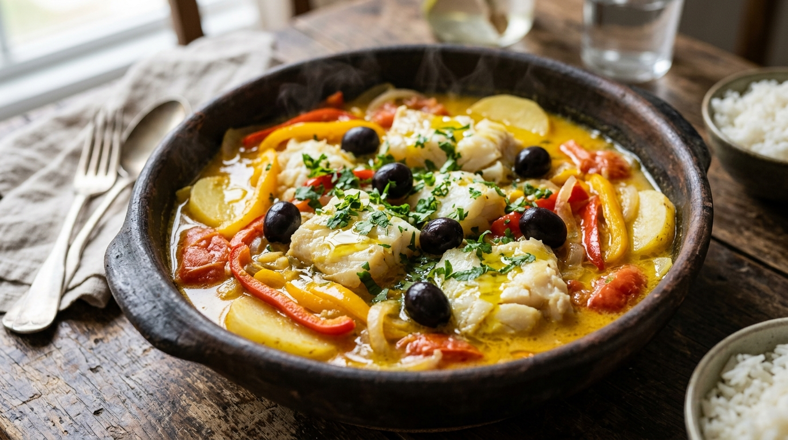

# Bacalhau ao Leite de Coco 🐟🥥 📝

*Uma criação sublime que celebra o encontro apaixonante entre a tradição lusitana e a alma tropical brasileira. O bacalhau nobre, com suas lascas tenras e sabor marcante do mar, é delicadamente abraçado pela cremosidade aveludada do leite de coco e pelo frescor aromático do refogado de tomates e pimentões. As batatas macias absorvem todos os sucos dessa alquimia perfumada, criando uma experiência reconfortante de mesa farta, almoço de domingo e memória de família.*

---

### ℹ️ Informações Gerais 📋
- **Tempo de preparo:** 45 minutos (além do tempo de dessalga prévia) ⏱️
- **Rendimento:** 6 porções 🍽️
- **Categorias:** Salgados / Peixes e Frutos do Mar / Prato Principal 🐟🥥

---

### 📷 Foto do Prato 🤤
  

---

### 🛒 Ingredientes 🧂

#### Bacalhau e Base de Legumes 🐟🥔
- [ ] 1 kg de bacalhau dessalgado em postas ou lascas nobres (Gadus morhua ou Saithe) 🐟
- [ ] 6 batatas médias tipo Monalisa ou Asterix (aprox. 800g), descascadas e cozidas *al dente* em rodelas médias 🥔
- [ ] 4 colheres de sopa de azeite de oliva extravirgem de boa acidez 🫒
- [ ] 1 cebola média em rodelas finas ou brunoise delicada 🧅
- [ ] 4 dentes de alho frescos finamente laminados 🧄
- [ ] 1/2 pimentão amarelo em tiras finas (suave e adocicado) 🫑
- [ ] 1/2 pimentão vermelho em tiras finas (sem pele para digestibilidade perfeita) 🫑
- [ ] 5 tomates maduros picados sem sementes (ou 1 lata de tomate pelado italiano) 🍅

#### Caldo Cremoso e Aromáticos 🥥🌿
- [ ] 400ml de leite de coco cremoso integral (2 garrafinhas de 200ml ou leite de coco artesanal fresco) 🥥
- [ ] 1 colher de sobremesa de colorau moído puro ou páprica doce espanhola 🌶️
- [ ] 1 maço de coentro fresco finamente picado (ou salsinha fresca picadinha a gosto) 🌿
- [ ] Sal marinho ou flor de sal a gosto (com moderação, atentando ao residual do bacalhau) 🧂
- [ ] Pimenta-do-reino moída na hora a gosto 🌶️
- [ ] 10 a 12 azeitonas pretas portuguesas carnudas para decorar 🫒

---

### 🍳 Modo de Preparo 👩‍🍳

#### 1. Dessalga Correta e Cozimento das Batatas 🥔💧
1. Com antecedência de 24 a 48 horas (dependendo da espessura das postas), hidrate e dessalgue o bacalhau imerso em água fria dentro da geladeira, trocando a água de 6 em 6 horas.
2. Em uma panela com água fervente e uma pitada sutil de sal, cozinhe as rodelas de batata por cerca de 8 a 10 minutos, até ficarem firmes porém macias ao toque de um garfo (*al dente*). Escorra com delicadeza para não desmanchar e reserve.

#### 2. Refogado dos Aromáticos e Sofrito de Tomates 🧅🍅
1. Em uma panela de fundo grosso, caçarola de ferro esmaltado ou panela de barro larga, aqueça o azeite de oliva extravirgem em fogo médio.
2. Adicione a cebola e refogue suavemente até ficar transparente e perfumada. Junte o alho laminado e doure levemente, sem deixar queimar para não amargar.
3. Acrescente as tiras de pimentão amarelo e vermelho e refogue por 2 minutos até amaciarem.
4. Junte os tomates maduros picados e o colorau (ou páprica doce). Misture bem e cozinhe por 5 minutos em fogo brando, formando um sofrito úmido, aromático e de cor vívida.

#### 3. Acomodação do Bacalhau e Cozimento Inicial 🐟🔥
1. Tempere levemente o refogado com pimenta-do-reino moída na hora e uma pitada cautelosa de sal.
2. Abra espaço na panela e acomode as postas ou lascas nobres de bacalhau dessalgado diretamente sobre a base de refogado, cobrindo parte com o molho de tomate aromático.
3. Tampe a panela e deixe cozinhar em fogo baixo por cerca de 10 minutos, permitindo que o bacalhau libere seus sucos ricos em gelatina natural e perfume todo o molho.

#### 4. Aveludado de Leite de Coco e Incorporação das Batatas 🥥🥔
1. Abra a panela e verta delicadamente o leite de coco cremoso sobre o bacalhau e o refogado, envolvendo o fundo suavemente com movimentos circulares da panela (evite mexer com colher para manter as postas inteiras).
2. Distribua as rodelas de batata reservadas entre as postas de bacalhau, para que mergulhem parcialmente no caldo aveludado e absorvam todos os sabores.
3. Deixe apurar semi-tampado em fogo brando por mais 10 a 12 minutos, até que o molho reduza ligeiramente e ganhe corpo sedoso e brilhante.
4. Prove o caldo e ajuste o sal e a pimenta-do-reino, se necessário.

#### 5. Finalização Aromática e Empratamento Artístico 🍽️🌿
1. Desligue o fogo e polvilhe imediatamente o coentro fresco picadinho (ou salsinha) sobre toda a extensão da caçarola, mantendo o frescor dos óleos essenciais.
2. Distribua as azeitonas pretas portuguesas inteiras harmoniosamente pelo prato e regue com um fio final de azeite extravirgem cru.
3. Sirva na própria caçarola ou em travessa funda aquecida, acompanhado de arroz branco soltinho e uma farofa crocante de alho ou pirão preparado com o próprio caldo da cocção.

---

### 💡 Dicas e Variações do Chef ✨
- *Dessalga de Ouro na Geladeira:* Mantenha o bacalhau obrigatoriamente sob refrigeração durante todo o processo de dessalga. Em temperatura ambiente, o peixe fermenta e perde textura. A água gelada preserva a rigidez das fibras musculares e assegura que o bacalhau lasque perfeitamente ao servir.
- *Variação Baiana e Picante:* Para uma versão com pegada de Moqueca Tradicional, incorpore 1 colher de sopa de azeite de dendê legítimo ao refogado inicial e 1 pimenta-de-cheiro picadinha sem sementes. O dendê traz um perfume terroso inconfundível que contrasta harmoniosamente com a doçura natural do leite de coco.
- *Conservação e Sabor do Dia Seguinte:* Pratos de bacalhau com molhos aveludados ficam ainda mais ricos no dia seguinte, após as batatas e o peixe maturarem no caldo. Conserve em recipiente hermético na geladeira por até 3 dias. Para reaquecer, utilize fogo bem baixo, adicionando 2 colheres de água ou leite de coco se o molho estiver muito espesso.

---

📖 [« Voltar para o Índice Geral](../README.md) | 🍕 [« Voltar para o Índice de Salgados](INDEX_SALGADOS.md) | 📋 [« Voltar ao Índice Completo](INDEX_COMPLETO.md)
