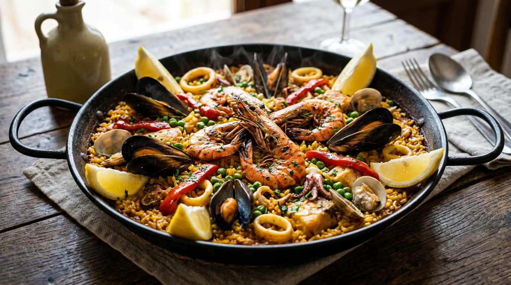

# Paella Tradicional de Frutos do Mar 🥘🦐🦑 📝

*Ícone supremo da gastronomia espanhola nascido nos campos ensolarados de Valência, a Paella transcende o conceito de refeição: é um ritual de celebração e convívio. Nesta versão marítima clássica (*Paella Marinera*), cada grão de arroz absorve um caldo marinho intensamente aromático tingido com os tons dourados do açafrão verdadeiro e o perfume da páprica doce espanhola. A combinação harmoniosa de camarões dourados, lulas tenras salteadas no azeite extravirgem e mexilhões abertos no próprio vapor culmina no maior troféu de um bom mestre paelleiro: o irresistível **socarrat**, a crostinha de arroz caramelizada e crocante formada no fundo da paellera.*

---

### ℹ️ Informações Gerais 📋
- **Tempo de preparo:** 50 minutos ⏱️
- **Rendimento:** 6 a 8 porções 🍽️
- **Categorias:** Salgados / Espanhola / Peixes e Frutos do Mar / Arroz 🥘🦐🦑

---

### 📷 Foto do Prato 🤤
  

---

### 🛒 Ingredientes 🧂

#### Frutos do Mar Selecionados 🦐🦑🦪
- [ ] 500g de camarões médios limpos e eviscerados (com a cauda preservada) 🦐
- [ ] 6 a 8 camarões grandes inteiros (com cabeça e casca, para dourar e decorar) 🦐✨
- [ ] 300g de lulas frescas limpas (tubos cortados em anéis de 1cm e tentáculos inteiros) 🦑
- [ ] 300g de mexilhões frescos na concha (bem escovados, sem barbas e lavados) 🦪
- [ ] 5 colheres de sopa de azeite de oliva extravirgem 🫒

#### O Sofrito e os Grãos 🍅🧅🌾
- [ ] 500g de arroz especial para paella (variedade *Bomba* ou *Calasparra*; alternativamente arroz parboilizado ou carnaroli) 🌾
- [ ] 3 tomates maduros sem pele picados em cubinhos mínimos (*concasse*) ou ralados 🍅
- [ ] 1 cebola média picada finamente (*brunoise*) 🧅
- [ ] 4 dentes de alho picadinhos ou laminados 🧄
- [ ] 1 pimentão vermelho cortado em tiras finas longitudinais 🫑
- [ ] 1 xícara de chá (150g) de ervilhas frescas ou congeladas (nunca use em conserva) 🟢

#### Caldo Aromático e Especiarias de Valência 🍲✨
- [ ] 1,2 a 1,4 litros de caldo de peixe e camarão caseiro (ou caldo de legumes artesanal bem aromático), mantido bem quente 🍲
- [ ] 1 colher de café de pistilos de açafrão verdadeiro (*azafrán*) levemente tostados e moídos (ou 1 colher de chá de açafrão-da-terra / cúrcuma de alta qualidade) 🌾💛
- [ ] 1 colher de sopa de páprica doce espanhola (*pimentón dulce de la Vera*) 🌶️
- [ ] 1 colher de café de páprica defumada 💨
- [ ] Sal e pimenta-do-reino moída na hora a gosto 🧂

#### Finalização e Decoração Tradicional 🍋🌿
- [ ] 2 limões sicilianos cortados em quatro (em gomos) 🍋
- [ ] 3 colheres de sopa de salsinha fresca finamente picada 🌿

---

### 🍳 Modo de Preparo 👩‍🍳

#### 1. Mise en Place e Infusão do Açafrão 🔪🍲
1. Aqueça 1 concha do caldo quente em uma xícara, adicione os pistilos de açafrão moídos e deixe em infusão por 10 minutos para liberar toda a cor dourada e o aroma terroso característico. Mantenha o restante do caldo bem quente em fogo baixo ao lado da paellera.
2. Certifique-se de que os mexilhões estão rigorosamente limpos e fechados (descarte qualquer mexilhão que permaneça aberto antes do cozimento). Seque bem os camarões e os anéis de lula com papel-toalha.

#### 2. Selagem dos Frutos do Mar (Construção da Camada de Sabor) 🔥🦐
1. Aqueça uma paellera tradicional de ferro ou aço carbono (de 36 a 40cm) em fogo médio-alto com 3 colheres de azeite de oliva extravirgem.
2. Adicione os camarões grandes inteiros de decoração e sele por apenas 1 minuto e meio de cada lado até ficarem rosados e crocantes. Retire e reserve em um prato à parte.
3. Na mesma paellera perfumada, adicione os camarões médios e os anéis de lula. Salteie rapidamente em fogo alto por apenas 2 minutos até que a lula mude de cor e fique tenra (atenção: cozinhar demais nesta fase deixará a lula borrachuda). Retire imediatamente e reserve junto aos camarões.

#### 3. O Autêntico Sofrito Espanhol 🍅🫑
1. Adicione as 2 colheres restantes de azeite na paellera. Coloque as tiras de pimentão vermelho e refogue por 2 minutos até dourarem; retire algumas tiras para usar na decoração final e mantenha o restante na panela.
2. Acrescente a cebola picadinha e refogue em fogo médio até ficar translúcida. Adicione o alho picado e refogue por mais 1 minuto sem deixar queimar.
3. Incorpore os tomates picados, a páprica doce e a páprica defumada. Cozinhe mexendo sempre por cerca de 4 a 5 minutos, até o tomate desmanchar e formar uma pasta densa, avermelhada e brilhante — o tradicional *sofrito* espanhol, que é a espinha dorsal de sabor da paella.

#### 4. Nacagem do Arroz e Adição do Caldo Dourado 🌾🍲
1. Despeje o arroz sobre o sofrito e mexa vigorosamente por 2 minutos (*nacagem*), garantindo que cada grão de arroz seja envolto pelo azeite aromatizado e pelos temperos.
2. Espalhe o arroz de maneira uniforme por todo o fundo da paellera.
3. Despeje a infusão de açafrão e cerca de 1 litro do caldo fervente sobre o arroz. Tempere o líquido com sal e pimenta-do-reino a gosto. 
4. **Regra de Ouro da Paella:** Cozinhe em fogo médio-alto nos primeiros 8 a 10 minutos até o caldo baixar até a altura do arroz. **A partir deste momento, jamais mexa o arroz com colher ou espátula**, para não quebrar o amido e permitir que ele cozinhe soltinho e forme a crosta no fundo.

#### 5. Acomodação dos Frutos do Mar e Criação do Socarrat 🦪✨
1. Reduza o fogo para brando. Distribua de maneira harmoniosa e decorativa os anéis de lula, os camarões médios reservados e as ervilhas sobre a superfície do arroz.
2. Acomode os mexilhões com a concha virada para cima, pressionando levemente no arroz.
3. Decore o topo com os camarões grandes inteiros e as tiras de pimentão vermelho reservadas.
4. Deixe cozinhar em fogo baixo por mais 8 a 10 minutos. O vapor que sobe do arroz cozinhará os mexilhões até suas conchas se abrirem por completo (descarte os que não abrirem) e terminará a cocção perfeita dos frutos do mar sem ressecar. Se o arroz estiver secando antes de amaciar, borrife delicadamente algumas conchas adicionais de caldo quente pelas bordas.
5. **O Socarrat Perfeito:** Nos últimos 2 minutos de cocção, aumente a chama para média-alta. Você ouvirá um som de estalos sutis (*crepitar*) e sentirá um aroma tostado característico (sem cheiro de queimado). Desligue o fogo imediatamente.

#### 6. Descanso e Serviço Tradicional 🍽️🍋
1. Cubra a paellera com um pano de prato limpo ou papel-alumínio e deixe descansar fora do fogo por 5 minutos antes de servir. Esse repouso equilibra a umidade e assenta os sabores.
2. Retire a cobertura, decore com folhas de salsinha fresca picadinha e distribua os gomos de limão siciliano nas bordas da paellera.
3. Leve a paellera inteira diretamente ao centro da mesa para que todos os convidados possam apreciar as cores exuberantes antes de servir com uma espátula, raspando bem o fundo para compartilhar pedaços crocantes do cobiçado *socarrat*.

---

### 💡 Dicas e Variações do Chef ✨
- *O Segredo Supremo do Socarrat:* O *socarrat* é a crosta dourada e caramelizada de arroz que se forma no fundo da panela devido à caramelização dos açúcares e gorduras com o amido. O segredo é nunca mexer no arroz após o início do cozimento do caldo e dar um choque térmico de fogo um pouco mais forte no finalzinho. Para checar, espete delicadamente uma colher no fundo: você deve sentir uma resistência crocante sem resistência de grão cru.
- *Correção de Erros de Receitas Caseiras Comuns:* Muitas receitas amadoras esquecem de cozinhar a lula ou colocam mexilhões e camarões crus apenas nos últimos minutos sem selagem prévia, soltando excesso de água fria no prato. Saltear os frutos do mar no início cria a base caramelizada do azeite, e colocá-los de volta na etapa certa garante textura tenra, suculência e conchas perfeitamente abertas.
- *Caldo Caseiro é Vida:* Evite cubos de caldo industrializados com excesso de sódio. Para um caldo de chef, ferva as cabeças e cascas dos camarões limpos com 1 talo de salsão, 1 cebola com casca, 1 folha de louro e pimenta em grãos por 20 minutos; coe e use fervente na paella.

---

📖 [« Voltar para o Índice Geral](../README.md) | 🍕 [« Voltar para o Índice de Salgados](INDEX_SALGADOS.md) | 📋 [« Voltar ao Índice Completo](INDEX_COMPLETO.md)
