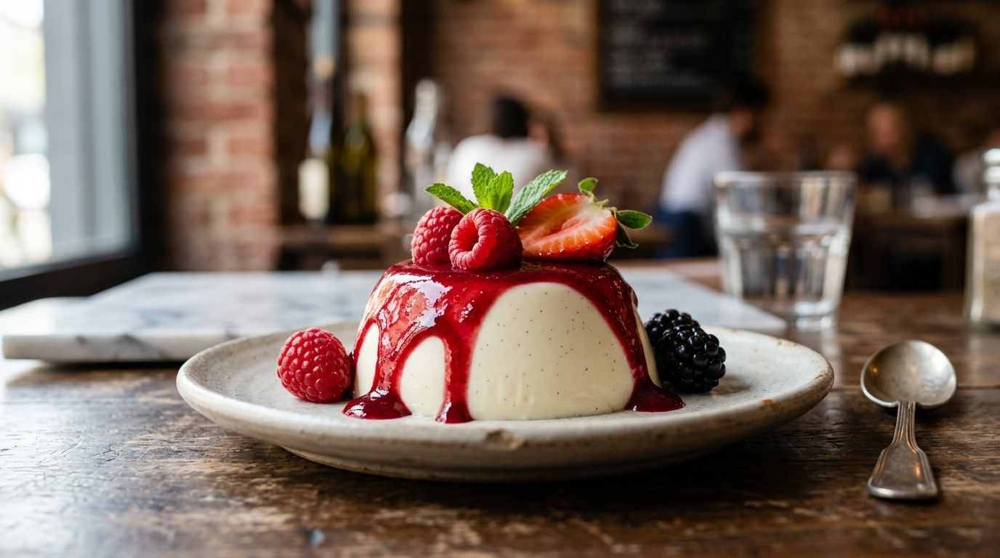

# Panacota Tradicional com Frutas Vermelhas 🍮🍓 📝

*Clássica, delicada e aveludada sobremesa originária da região do Piemonte, no norte da Itália. "Panna cotta" significa literalmente "creme cozido" e conquistou o mundo com sua textura incrivelmente sedosa que derrete suavemente a cada colherada. O contraste entre a rica suavidade do creme de baunilha e o frescor cítrico da calda de frutas vermelhas transforma qualquer momento em uma celebração inesquecível.*

---

### ℹ️ Informações Gerais
- **Tempo de preparo:** 25 minutos (+ 4 horas de geladeira) ⏱️
- **Rendimento:** 6 porções 🍽️
- **Categorias:** Doce / Sobremesa / Gelado / Italiano 🍮🍓

---

### 📷 Foto do Prato

---

### 🛒 Ingredientes

#### Creme de Panacota
- [ ] 500ml de creme de leite fresco (ou nata com alto teor de gordura) 🥛
- [ ] 100ml de leite integral 🥛
- [ ] 80g de açúcar refinado (cerca de 1/2 xícara de chá) 🍚
- [ ] 1 fava de baunilha aberta e com sementes raspadas (ou 1 colher de sopa de extrato de baunilha de boa qualidade) 🌿✨
- [ ] 6g de gelatina incolor em pó sem sabor (1/2 sachê) 🥄
- [ ] 3 colheres (sopa) de água fria (para hidratar a gelatina) 💧
- [ ] 1 pitadinha de sal 🧂

#### Calda de Frutas Vermelhas
- [ ] 300g de frutas vermelhas frescas ou congeladas (morangos, framboesas, amoras e mirtilos) 🍓🫐
- [ ] 1/2 xícara (chá) de açúcar cristal ou refinado 🍚
- [ ] Suco de 1/2 limão siciliano 🍋
- [ ] 2 colheres (sopa) de água 💧

#### Decoração e Finalização
- [ ] Frutas vermelhas frescas inteiras para decorar 🍓🫐
- [ ] Folhas de hortelã fresca 🌱

---

### 🍳 Modo de Preparo

#### Preparo do Creme
1. Em uma tigela pequena, hidrate a gelatina incolor polvilhando-a sobre as 3 colheres de sopa de água fria. Deixe descansar por 5 minutos.
2. Em uma panela média de fundo grosso, adicione o creme de leite fresco, o leite integral, o açúcar refinado, a pitadinha de sal e as sementes raspadas da fava de baunilha (junto com a fava).
3. Leve ao fogo médio-baixo, mexendo delicadamente com uma espátula para dissolver o açúcar. Aqueça até começar a fumegar e formar pequenas bolhas nas bordas da panela, sem deixar ferver completamente.
4. Desligue o fogo e retire a fava de baunilha. Adicione a gelatina hidratada diretamente ao creme quente e mexa bem com um batedor de arame (fouet) até que ela se dissolva por completo e se incorpore perfeitamente ao creme.
5. Deixe a mistura amornar em temperatura ambiente por cerca de 10 a 15 minutos.
6. Despeje o líquido em forminhas individuais (ramequins ligeiramente untados com um fio de óleo neutro se preferir desenformar) ou em elegantes taças de sobremesa.
7. Cubra com plástico filme e leve à geladeira por no mínimo 4 a 6 horas (ou de um dia para o outro) até que fique firme, mantendo aquele balanço cremoso característico.

#### Preparo da Calda de Frutas Vermelhas
1. Em uma panela pequena, misture as frutas vermelhas picadas grosseiramente, o açúcar, o suco de limão e a água.
2. Cozinhe em fogo baixo por cerca de 8 a 10 minutos, mexendo ocasionalmente e amassando ligeiramente algumas frutas com a espátula, até formar uma calda brilhante, levemente espessa e com pedacinhos rústicos de frutas.
3. Desligue o fogo e deixe esfriar completamente antes de usar (leve à geladeira se preferir servir bem fria).

#### Montagem e Finalização
1. Se for desenformar, passe rapidamente o fundo de cada forminha em água morna por 3 segundos e solte suavemente a borda com a pontinha de uma espátula ou faca lisa. Vire com cuidado no centro de um prato de sobremesa. Se montou em taças, pule esta etapa.
2. Cubra o topo da panacota generosamente com a calda de frutas vermelhas gelada, permitindo que escorra suavemente pelas laterais.
3. Finalize decorando com frutas frescas inteiras e uma folhinha de hortelã fresca para um contraste de cores vibrante. Sirva bem geladinha!

---

### 💡 Dicas e Variações
- *O segredo da textura perfeita:* A panacota ideal não deve ter textura de gelatina dura; ela deve ser cremosa, sedosa e vibrar suavemente ao toque da colher (*o famoso jiggle*). Não aumente a quantidade de gelatina.
- *Creme de leite:* Utilize sempre creme de leite fresco ou pasteurizado de garrafinha com teor de gordura acima de 35%. Cremes de caixinha UHT possuem espessantes e menor teor de gordura, alterando a textura sedosa original.
- *Variações de cobertura:* Além das frutas vermelhas, combina com calda de maracujá com sementinhas crocantes, calda de manga com gengibre, caramelo salgado (*toffee*) ou ganache de chocolate meio amargo.

---

📖 [« Voltar para o Índice Geral](../README.md) | 🍰 [« Voltar para o Índice de Doces](INDEX_DOCES.md) | 📋 [« Voltar ao Índice Completo](INDEX_COMPLETO.md)
