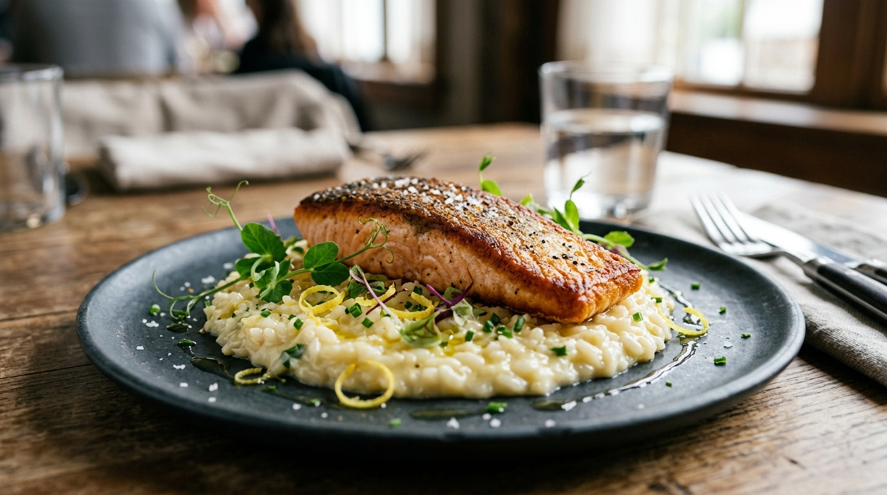

# Risoto de Limão Siciliano com Salmão Grelhado 🍋🐟 📝

*Um clássico da gastronomia mediterrânea que une o frescor cítrico e aveludado do risoto à nobreza e untuosidade do salmão perfeitamente grelhado. A acidez elegante do limão siciliano corta a riqueza do queijo e da manteiga, enquanto a pele crocante do peixe contrasta de forma sublime com a cremosidade all'onda do arroz. Uma receita que transforma qualquer jantar em uma celebração memorável.*

---

### ℹ️ Informações Gerais 📋
- **Tempo de preparo:** 45 minutos ⏱️
- **Rendimento:** 4 porções 🍽️
- **Categorias:** Salgados / Risotos / Peixes e Frutos do Mar 🍋🐟

---

### 📷 Foto do Prato 🤤
  

---

### 🛒 Ingredientes 🧂

#### Salmão Grelhado com Ervas 🐟🌿
- [ ] 4 filés de salmão com pele (aprox. 180g a 200g cada, em temperatura ambiente) 🐟
- [ ] 2 colheres de sopa de azeite de oliva extravirgem 🫒
- [ ] 1 colher de sopa de manteiga sem sal 🧈
- [ ] 2 ramos de tomilho fresco (somente as folhas) 🌿
- [ ] 1 ramo de alecrim fresco 🌿
- [ ] Sal marinho ou flor de sal a gosto 🧂
- [ ] Pimenta-do-reino moída na hora a gosto 🌶️

#### Caldo Aromático de Legumes 🍲🥕
- [ ] 1,5 litro de água filtrada 💧
- [ ] 1 cenoura média cortada em rodelas grossas 🥕
- [ ] 1 talo de salsão (aipo) com folhas 🥬
- [ ] 1 cebola média cortada ao meio 🧅
- [ ] 2 dentes de alho levemente amassados com casca 🧄
- [ ] 1 folha de louro 🍃
- [ ] Grãos de pimenta-do-reino preta 🧂

#### Risoto de Limão Siciliano 🍚🍋
- [ ] 320g de arroz para risoto (Arbóreo ou Carnaroli de grão nobre) 🌾
- [ ] 1 cebola branca pequena picada finamente em brunoise 🧅
- [ ] 2 colheres de sopa de azeite de oliva extravirgem 🫒
- [ ] 150ml de vinho branco seco (Sauvignon Blanc ou Pinot Grigio em temperatura ambiente) 🍷
- [ ] Suco de 1 limão siciliano fresco coado 🍋

#### Mantecatura e Finalização 🧈🧀
- [ ] 60g de manteiga sem sal bem gelada cortada em cubos 🧈
- [ ] 80g de queijo Parmigiano-Reggiano ou Grana Padano ralado finamente na hora 🧀
- [ ] Raspas finas da casca de 2 limões sicilianos (sem a parte branca amarga) 🍋
- [ ] 2 colheres de sopa de ciboulette ou cebolinha francesa picada bem fininha 🌿
- [ ] Pimenta-do-reino moída na hora para o toque final 🧂

---

### 🍳 Modo de Preparo 👩‍🍳

#### 1. Caldo Aromático (Infusão Base) 🍲
1. Em uma panela média, adicione a água, a cenoura, o salsão, a cebola, o alho amassado, o louro e os grãos de pimenta.
2. Leve ao fogo médio e, assim que levantar fervura, reduza a chama para o mínimo. Deixe borbulhar suavemente com a panela semi-tampada por cerca de 25 minutos para que os sabores se concentrem.
3. Mantenha o caldo sempre bem quente e fumegante ao lado da panela do risoto durante todo o cozimento, coando na hora de regar.

#### 2. Risoto de Limão Siciliano (Tostatura e Cocção) 🍚
1. Em uma panela de fundo espesso ou caçarola larga, aqueça o azeite de oliva em fogo médio. Adicione a cebola em brunoise e refogue delicadamente com uma pitada de sal até ficar translúcida, sem dourar para não manchar o risoto.
2. Acrescente o arroz arbóreo/carnaroli e faça a **tostatura**: mexa continuamente por 2 a 3 minutos até que os grãos fiquem nacarados e quentes ao toque. Esse selamento protege o grão para manter o coração *al dente*.
3. Verta o vinho branco seco e faça a **deglaçagem**, raspando os sabores do fundo da panela com uma colher de pau ou espátula de silicone. Deixe o álcool evaporar completamente, restando apenas a acidez aromática da uva.
4. Comece a adicionar o caldo fervente, concha por concha, mexendo suavemente em movimentos circulares em forma de oito para que a fricção entre os grãos libere o amido natural.
5. Só adicione uma nova concha quando a anterior estiver quase totalmente absorvida.
6. Aos 12 minutos de cozimento, adicione o suco de limão siciliano coado. Continue adicionando caldo até que o arroz atinja o ponto perfeito: macio por fora, firme no centro (*al dente*), o que leva entre 16 e 18 minutos.

#### 3. Salmão Grelhado com Pele Crocante 🐟🔥
1. Seque muito bem a superfície e a pele dos filés de salmão com papel-toalha (a ausência de umidade é o segredo da pele ultracrocante).
2. Com a ponta de uma faca afiada, faça incisões superficiais na diagonal da pele para que o calor penetre uniformemente e o filé não empene. Tempere ambos os lados com sal marinho e pimenta-do-reino moída na hora.
3. Aqueça uma frigideira de fundo grosso (preferencialmente de ferro ou aço inoxidável) com o azeite em fogo médio-alto até começar a fumegar levemente.
4. Deposite os filés com a **pele voltada para baixo**. Pressione suavemente cada filé com uma espátula pelos primeiros 20 segundos para manter contato integral com a frigideira.
5. Deixe grelhar sem mexer por cerca de 4 a 5 minutos, até observar a pele profundamente dourada e crocante (pela Reação de Maillard) e o cozimento atingir 2/3 da espessura do peixe.
6. Vire os filés, adicione a manteiga, o tomilho e o alecrim na frigideira. Regue o peixe continuamente com a manteiga espumante aromática com auxílio de uma colher por apenas 1 minuto e meio. O centro deve permanecer rosado e suculento.
7. Retire do fogo e deixe repousar por 2 minutos sobre uma tábua morna antes de empratar.

#### 4. Mantecatura e Empratamento Artístico 🍽️✨
1. Desligue o fogo do risoto. Adicione a manteiga sem sal bem gelada e o queijo parmesão ralado na hora.
2. Realize a **mantecatura**: bata vigorosamente o arroz com a espátula em movimentos circulares rápidos para provocar uma emulsão perfeita entre as gorduras frias e o amido quente do caldo, conferindo o ponto *all'onda* (cremoso e fluido, que desliza suavemente ao bater no fundo do prato).
3. Misture metade das raspas frescas de limão siciliano e acerte o sal e a pimenta-do-reino moída na hora.
4. Para servir: disponha uma porção generosa do risoto no centro de pratos rasos aquecidos. Dê leves batidinhas na base do prato para que o risoto se espalhe de forma uniforme e elegante.
5. Posicione o filé de salmão por cima, com a pele crocante voltada para cima para não perder a textura.
6. Finalize com as raspas restantes do limão siciliano, a ciboulette finamente fatiada, um fio delicado de azeite extravirgem e flor de sal sobre o salmão. Sirva imediatamente!

---

### 💡 Dicas e Variações do Chef ✨
- *Segredo das Raspas e Acidez:* Ao ralar o limão siciliano, use um ralador fino estilo microplane e passe a casca apenas uma única vez no mesmo ponto para não atingir a parte branca (albedo), que amarga a receita. Adicione as raspas somente na mantecatura fora do fogo para preservar os óleos essenciais voláteis e o frescor aromático intactos.
- *Ponto All'Onda Perfeito:* Um autêntico risoto italiano nunca deve ficar empelotado nem duro como um bloco no prato. A manteiga deve estar obrigatoriamente congelada ou muito gelada: o choque térmico entre a gordura gelada e o calor do arroz cria uma suspensão coloidal brilhante e sedosa que faz o risoto 'ondular'.
- *Harmonização de Sommelier:* Este prato harmoniza com maestria com vinhos brancos que tenham boa acidez estruturada e notas minerais, como um clássico Sauvignon Blanc do Vale dos Vinhedos ou Marlborough, um Chablis ou um refrescante espumante Brut Tradicional.

---

📖 [« Voltar para o Índice Geral](../README.md) | 🍕 [« Voltar para o Índice de Salgados](INDEX_SALGADOS.md) | 📋 [« Voltar ao Índice Completo](INDEX_COMPLETO.md)
